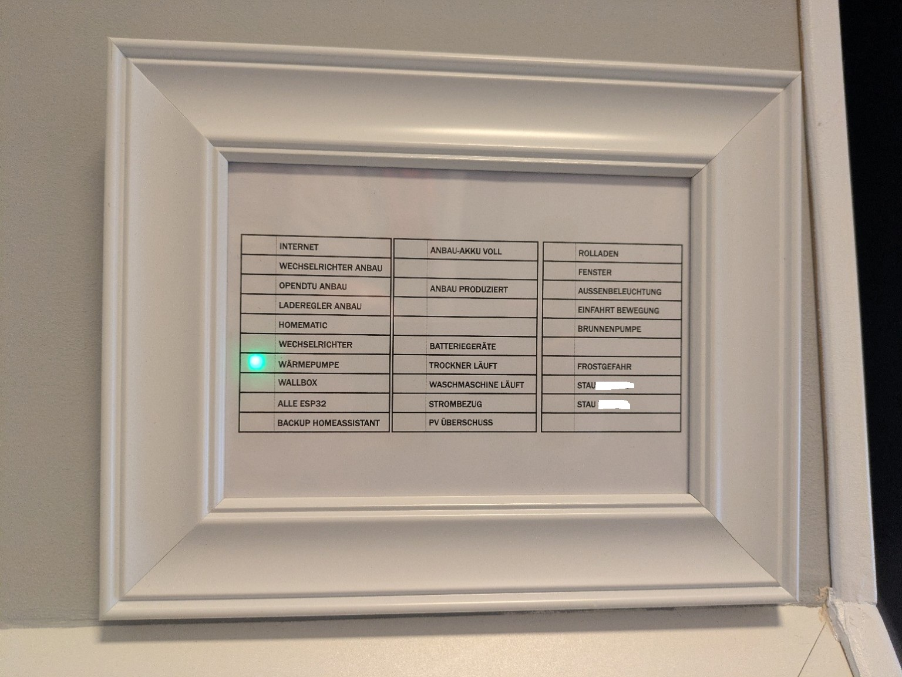
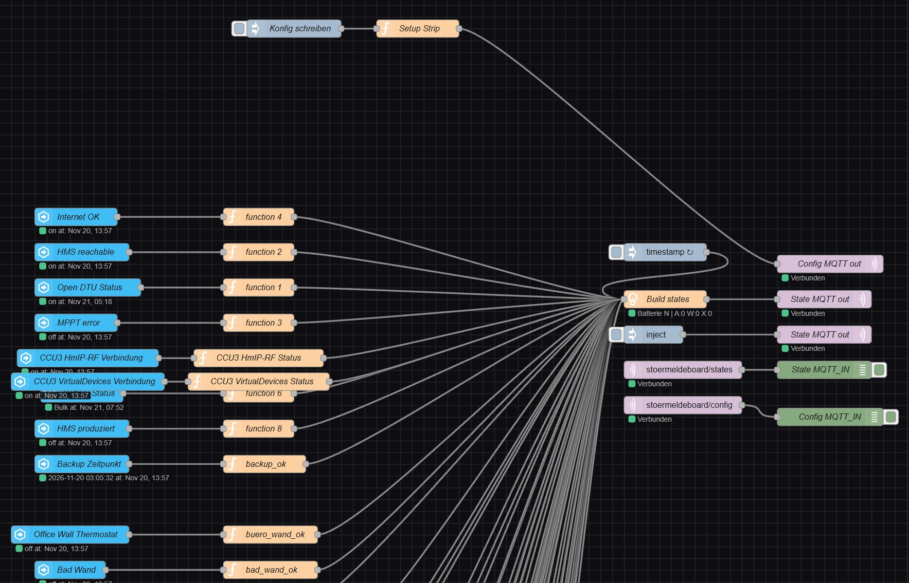

# HA StatusFrame



**A real-world ESP32 LED status display for Home Assistant.**

[View Hardware Documentation](hardware.md) |
[View Wiring Diagram](HA-StatusFrame_Wiring_Diagram_As-Built.svg)

**An ESP32-powered 30-LED status display for Home Assistant, ESPHome and Node-RED.**

This repository shares a real, personalized Home Assistant installation, not a generic plug-and-play product. It uses a 30-pixel WS2812B LED array to display device availability, energy flows, heating, household appliances, security-related states and other automation signals.

## Hardware

- ESP32-WROOM-32 / ESP32 DevKit
- 30 individually addressable WS2812B LEDs, arranged as **3 columns × 10 rows** in a serpentine layout
- LED data line: **GPIO18**
- Suitable 5 V power supply, shared ground with ESP32; size the supply for the LED load

> Check your LED strip's input voltage, power wiring and logic-level requirements. Do not power 30 LEDs at full brightness from an ESP32 GPIO pin.

## Architecture

```text
Home Assistant entities → Node-RED status logic → MQTT broker
                                              ├─ stoermeldeboard/states
                                              └─ stoermeldeboard/config
                                                            ↓
                                                   ESPHome / ESP32
                                                            ↓
                                                    30 WS2812B LEDs
```

### Node-RED Flow

Node-RED collects and processes various Home Assistant
entity states and combines them into a single status
message for the LED display.

The resulting status information is transmitted to
the ESP32 via MQTT.

The screenshot below shows an excerpt of the actual
Node-RED flow used in this project.



The complete Node-RED flow is available in the
[node-red](node-red/) directory.

## LED status tokens

| Token | Display | Meaning |
|---|---|---|
| `N` | Off | Normal / inactive |
| `NP` | Pulsing green | Active / operating normally |
| `A` | Solid red | Alarm |
| `AB` | Blinking red | Alarm / attention required |
| `H` | Pulsing blue | Notice |

Node-RED sends a JSON array with **30 tokens** to `stoermeldeboard/states` and configuration JSON to `stoermeldeboard/config`. The ESPHome configuration includes a startup LED test and a 15-second fallback to red if state messages stop arriving.

## Current personal LED assignment

| LED | Signal | LED | Signal |
|---:|---|---:|---|
| 1 | Internet connection | 16 | Battery-powered devices |
| 2 | Hoymiles availability | 17 | Dryer running |
| 3 | OpenDTU availability | 18 | Washing machine running |
| 4 | Victron availability | 19 | Grid import |
| 5 | Homematic CCU3 availability | 20 | Grid export |
| 6 | Sungrow inverter | 21 | Shutters |
| 7 | Heat pump | 22 | Open windows |
| 8 | Wallbox charging | 23 | Exterior lighting |
| 9 | ESP devices | 24 | Driveway motion |
| 10 | Home Assistant / Samba backup | 25 | Fountain pump |
| 11 | Victron battery full | 26 | Unused |
| 12 | Unused | 27 | Frost risk |
| 13 | Hoymiles producing | 28 | Commute: person 1 |
| 14 | Unused | 29 | Commute: person 2 |
| 15 | Unused | 30 | Unused |

The assignments describe this installation; your own entity IDs and thresholds will differ.

## Repository contents

- `esphome/ha-statusframe.yaml` — complete ESPHome configuration, including the original custom LED renderer
- `esphome/secrets.yaml.example` — placeholder values for local ESPHome secrets
- `node-red/ha-statusframe-flow.json` — full 133-node Node-RED export, with personal commute identifiers anonymized

## Installation

1. Install **ESPHome** and the **Node-RED Home Assistant integration** in your Home Assistant environment. You also need an MQTT broker accessible to both Node-RED and the ESP32.
2. Copy `esphome/ha-statusframe.yaml` into your ESPHome configuration directory. Copy `secrets.yaml.example` to your **local** `secrets.yaml` and fill in your own Wi-Fi, MQTT and API values. **Never upload the real secrets file.**
3. Review the ESP32 board and LED wiring, then validate and flash the ESPHome configuration.
4. In Node-RED, use **Menu → Import → select a file** and choose `node-red/ha-statusframe-flow.json`.
5. Configure the imported Home Assistant server connection and MQTT broker. The exported MQTT host `192.0.2.10` is a **documentation-only placeholder**, not a working broker address.
6. Replace all installation-specific Home Assistant entity IDs with your own. This includes `sensor.commute_person_1`, `sensor.commute_person_2`, and `device_tracker.sungrow_inverter`. Review all status thresholds and dependencies before deployment.
7. The imported flow tab is **disabled by default**. Enable it after adapting it to your installation. Avoid running two copies that publish to the same MQTT topics.
8. Deploy the Node-RED flow and verify that the ESP32 receives 30-element state arrays and the configuration message.

**Important:** This is a reference configuration from one installation. It is **not** ready to run in a different Home Assistant setup without adapting entity IDs, server connections, MQTT and wiring.

## Privacy

- No actual Wi-Fi passwords, MQTT passwords or API keys are included in the repository.
- Commute sensors and their Node-RED context keys have been anonymized consistently.
- The original private MQTT broker IP and an IP-derived device-tracker entity were replaced with placeholders.
- Other device and room entity IDs remain intentionally representative of the original setup. Review them before publishing if you prefer not to expose device names or home layout details.

## License

MIT — see [LICENSE](LICENSE).
