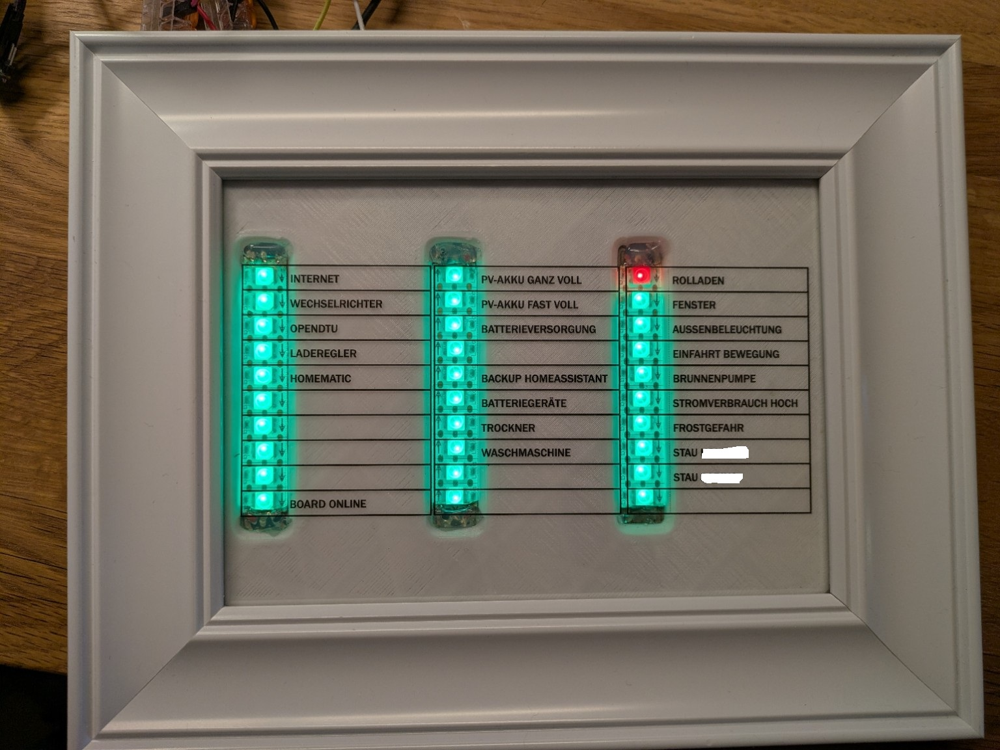
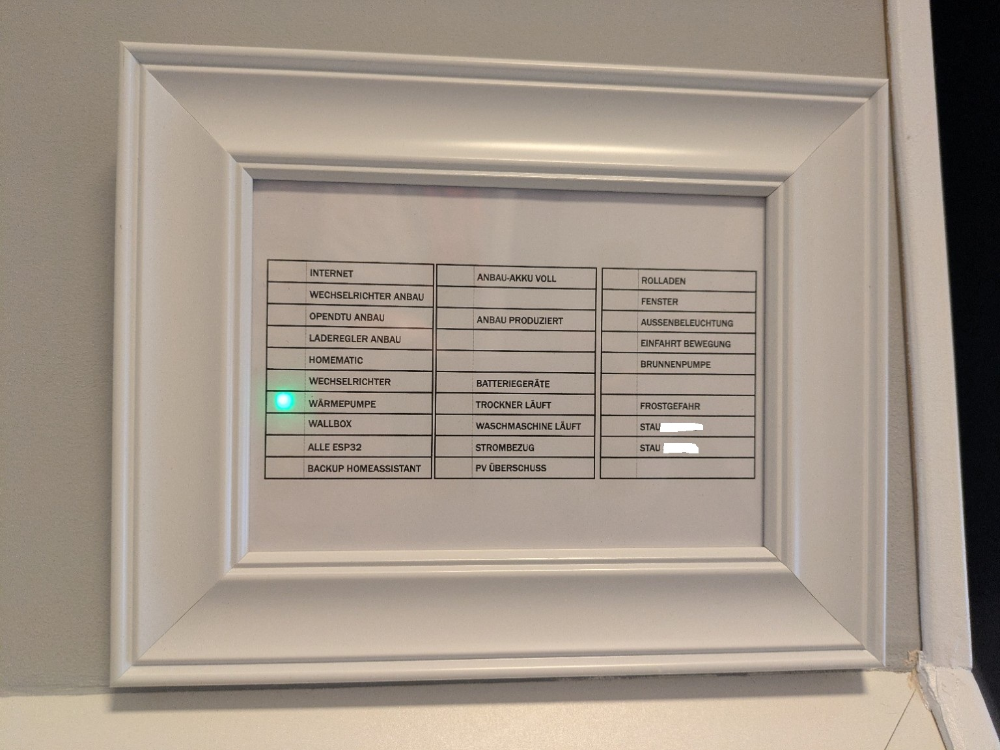
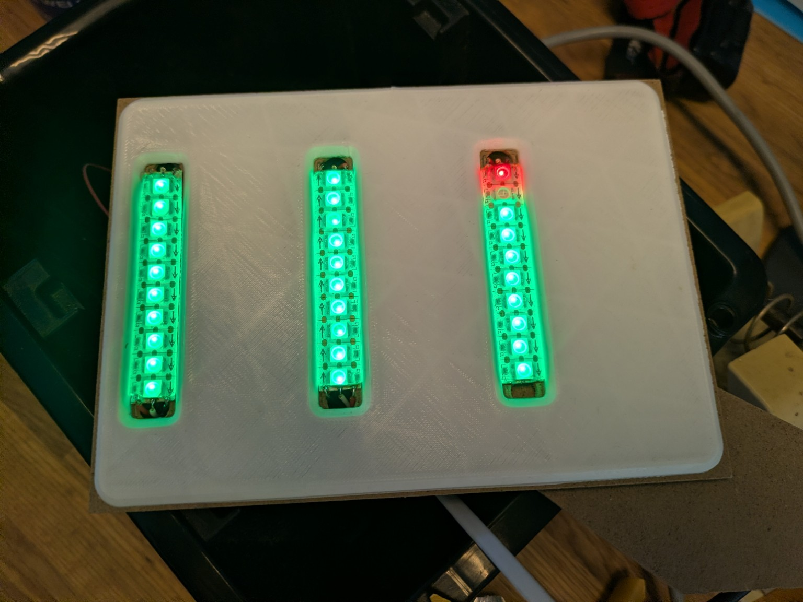
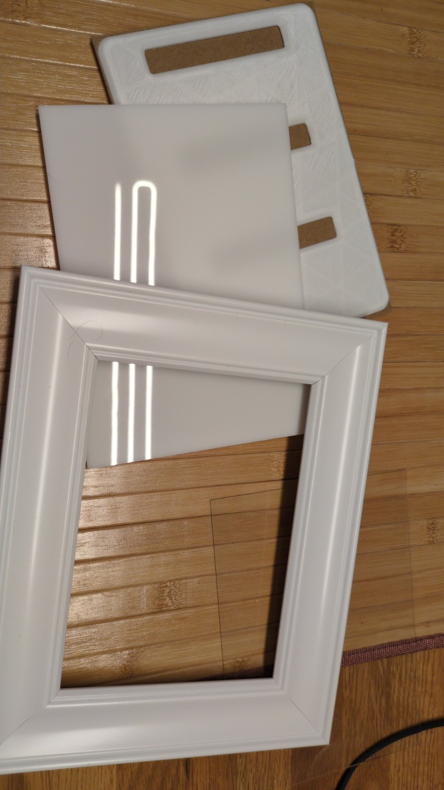
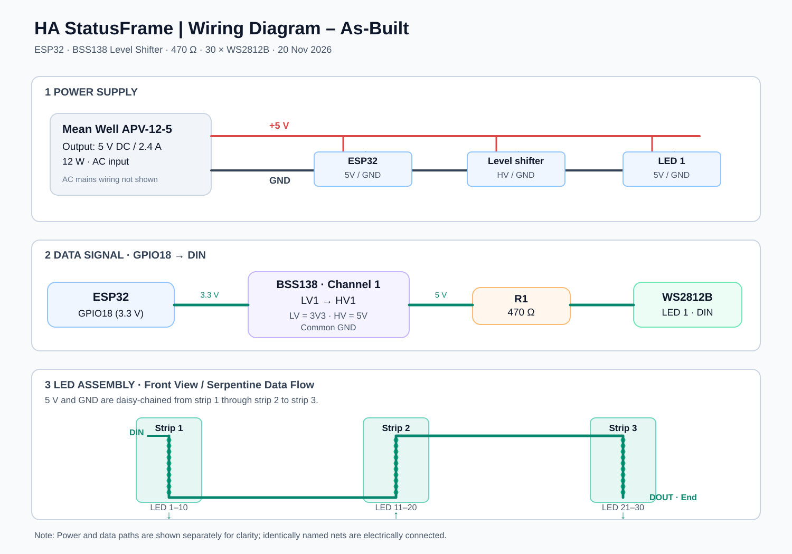
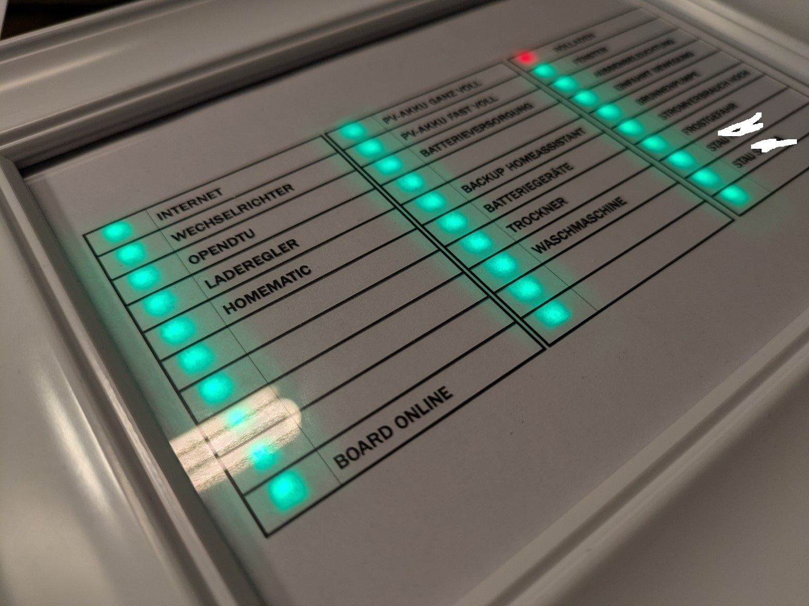

# HA StatusFrame – Hardware Documentation

This document describes the actual hardware implementation of
HA StatusFrame, a 30-LED status display for Home Assistant.

The project uses an ESP32 running ESPHome, controlled by
Home Assistant and Node-RED via MQTT.

## 1. Finished Project

The finished display is mounted inside a white picture frame.
It provides a visual overview of important smart home systems,
including network connectivity, solar power, heating,
household appliances and other automation states.

## 2. Hardware Components

| Component | Description |
|---|---|
| Microcontroller | ESP32-WROOM-32 DevKit |
| LEDs | 30 × WS2812B individually addressable RGB LEDs |
| Power supply | Mean Well APV-12-5, 5 V DC, 2.4 A, 12 W |
| Logic level converter | 4-channel BSS138 bidirectional level shifter |
| Data resistor | 470 Ω series resistor |
| Connections | WAGO connectors and jumper wires |
| LED carrier | Custom 3D-printed mounting plate |
| Enclosure | White picture frame with printed status labels |
| Firmware | ESPHome |
| Communication | Wi-Fi / MQTT |

## 3. Power Supply

The entire system is powered by a single Mean Well
APV-12-5 power supply.

Output specifications:

- Voltage: 5 V DC
- Maximum current: 2.4 A
- Rated power: 12 W

The ESP32 is powered directly through its 5V pin.

The LED strips receive their 5V supply from the same
power supply.

All components share a common ground.

The LED power connections are daisy-chained from
the first strip to the second and finally to the third.

The system is configured for reduced LED brightness
to limit power consumption.

## 4. Logic Level Conversion

The ESP32 generates a 3.3V data signal on GPIO18.

A BSS138-based logic level converter is used to
interface the ESP32 with the 5V WS2812B LEDs.

The following connections are used:

| ESP32 / Supply | Level Shifter |
|---|---|
| ESP32 GPIO18 | LV1 |
| ESP32 3V3 | LV |
| Power supply 5V | HV |
| Common GND | GND |

The converted data signal is taken from HV1.

A 470-ohm resistor is connected in series between
HV1 and the data input of the first LED strip.

Signal path:

`ESP32 GPIO18 → LV1 → HV1 → 470 Ω → WS2812B DIN`

Only channel 1 of the four-channel converter is used.

## 5. LED Arrangement

The display contains three vertical WS2812B LED strips,
each containing ten LEDs.

The strips are connected in a serpentine arrangement.

Viewed from the front:

- Strip 1 (left): Data flows from top to bottom.
- Strip 2 (middle): Data flows from bottom to top.
- Strip 3 (right): Data flows from top to bottom.

The first LED is located at the top left.
The final LED is located at the bottom right.

LED numbering:

| Strip | LED numbers | Direction |
|---|---|---|
| Left | 1–10 | Top → Bottom |
| Middle | 11–20 | Bottom → Top |
| Right | 21–30 | Top → Bottom |

The 5V and GND connections are also passed from
one strip to the next.

### LED Carrier

The LED strips are mounted inside a custom
3D-printed carrier with three vertical recesses.

## 6. Enclosure

The display is built into a conventional white picture frame.

The enclosure consists of:

- White picture frame
- Printed status label sheet
- Translucent front material
- 3D-printed LED carrier
- Rear mounting plate

The electronics and wiring are installed behind
the display inside a wall cavity.

## 7. Wiring Diagram

The following diagram documents the actual
electrical connections of the working installation.

The diagram includes:

- Shared 5V power supply
- ESP32 power and data connections
- Logic level converter
- 470-ohm data resistor
- Three daisy-chained LED strips
- Serpentine LED data routing

## 8. Additional Photos

### LED Detail

## 9. Software

The ESP32 runs ESPHome.

Home Assistant and Node-RED generate the individual
status messages and transmit them via MQTT.

The firmware and Node-RED configuration are available
in the corresponding folders of this repository.

## 10. Project Status

This documentation describes the original working
HA StatusFrame installation.

The hardware has been assembled and tested
in a real Home Assistant environment.

This is a documented personal implementation,
not a commercial product or universal hardware kit.
